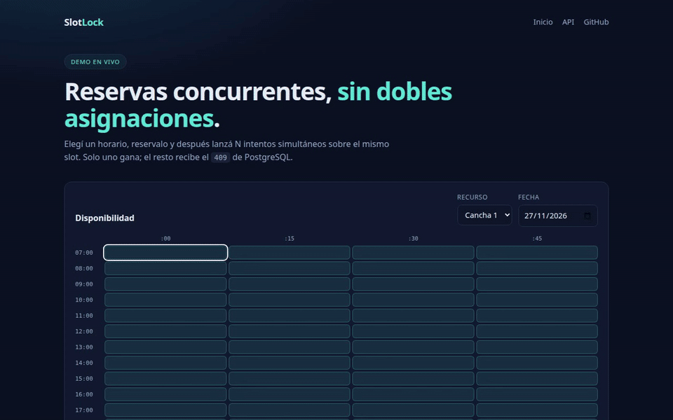

# SlotLock

> Sistema de reservas con concurrencia real: la exclusión de solapamientos vive en PostgreSQL, no en PHP.

[](https://github.com/jhonemmir/SlotLock/actions/workflows/ci.yml)


**Estado:** **v1 completo** y desplegado en Render + Neon (free): fases 0–7 cerradas.
Auth/ownership y rate limiting global quedan para v2; C/Go opcional fuera de scope. Ver [`docs/plan.md`](docs/plan.md).

---

## Qué demuestra

Dos usuarios intentan reservar el mismo recurso en el mismo horario, al mismo tiempo.
**Uno gana y el otro recibe un `409` determinista**, sin `SELECT` previos ni locks de
aplicación, porque la garantía es una restricción de PostgreSQL:

```sql
ALTER TABLE reservations
  ADD CONSTRAINT reservations_no_overlap
  EXCLUDE USING gist (
    resource_id WITH =,
    time_range  WITH &&
  ) WHERE (status IN ('held', 'confirmed'));
```

Bajo concurrencia real, PostgreSQL serializa los inserts por el índice GiST: el
primero commitea, el segundo viola la restricción con SQLSTATE `23P01` y la API lo
traduce a `409 slot_already_taken`. Un `SELECT ... WHERE overlaps` antes del insert
tiene TOCTOU por construcción: dos transacciones leen "libre" y ambas insertan.

Además del núcleo, el proyecto implementa:

- **Holds con TTL** (10 min) y expiración que no deja slots muertos ([ADR 0002](docs/adr/0002-expiracion-de-holds.md)).
- **Idempotencia obligatoria** por `Idempotency-Key` (UUID), con replay de la respuesta original.
- **Disponibilidad** por día en la zona horaria del recurso.
- **Tests contra PostgreSQL real** (nunca SQLite) y un test que verifica el SQLSTATE `23P01`.
- **Prueba de carga con k6**: 100 requests concurrentes al mismo slot → 1×201 y 99×409.
- **Horarios de operación** por recurso (incluye ventanas nocturnas) aplicados a reservas, waitlist y disponibilidad.
- **Waitlist** con promoción FIFO automática (`SKIP LOCKED`), hold corto y notificación.
- **Demo visual** con Blade + HTMX: grilla, conflicto visible y simulación de N intentos.
- **CI** con PostgreSQL 16, migraciones, aserción de la restricción y Pint.
- **Entorno reproducible**: la app entera corre en Docker (PHP-FPM + nginx + scheduler).

## Demo

**En vivo:** <https://slotlock-demo.onrender.com/demo>



La demo corre en Render free + Neon free: si estuvo inactiva, la primera visita
puede tardar ~1 min (cold start). Localmente: <http://localhost:8000/demo> con el
stack levantado.

- Grilla de disponibilidad por recurso y día (slots de 15 min).
- Reserva de un hold; si el slot ya está tomado, el `409` se ve en pantalla.
- Simulación de N requests concurrentes: 1 creada, N-1 rechazadas, con los tiempos.

La simulación server-side usa `Http::pool` contra la API real (una
`Idempotency-Key` distinta por intento). En Docker el `SIMULATE_BASE_URL` es
`http://nginx`; en local se usa `APP_URL`.

## Inicio rápido

Requisito: Docker + Docker Compose.

```bash
make setup
```

Eso levanta PostgreSQL, PHP-FPM, nginx y el scheduler; instala dependencias, genera
la clave, corre las migraciones y siembra 3 recursos.

- App: <http://localhost:8000>
- Demo: <http://localhost:8000/demo>
- Salud: <http://localhost:8000/health>
- Recursos: <http://localhost:8000/api/resources>

Otros comandos:

```bash
make test     # 43 tests contra PostgreSQL (crea slotlock_test si falta)
make k6       # same-slot + distinct-slots + idempotent-retry
make smoke    # smoke test contra http://localhost:8000
make fresh    # migrate:fresh + seed (borra los datos de demo)
make psql     # sesión psql sobre la DB de desarrollo
make lint     # Pint en modo verificación
make logs
```

> Si ves archivos `root` en `storage/`, corré `make fix-perms`.
> El UID/GID del contenedor se alinea con `HOST_UID`/`HOST_GID` (default 1000).
>
> La migración ejecuta `CREATE EXTENSION IF NOT EXISTS btree_gist`. En Docker el
> usuario es superusuario; en un PostgreSQL gestionado, el rol debe tener permiso
> para crear extensiones (o crearla una vez con un administrador).

## API

| Método | Ruta | Descripción |
|---|---|---|
| `GET` | `/api/resources` | Lista de recursos |
| `GET` | `/api/resources/{id}/availability?date=YYYY-MM-DD` | Grilla de 15 min (`free`/`held`/`confirmed`) |
| `POST` | `/api/reservations` | Crea un hold. Requiere `Idempotency-Key` y `X-Demo-Key` |
| `POST` | `/api/reservations/{id}/confirm` | Confirma un hold dentro del TTL (write: `X-Demo-Key`) |
| `DELETE` | `/api/reservations/{id}` | Cancela un hold o una reserva confirmada (write: `X-Demo-Key`) |
| `POST` | `/api/waitlist` | Registra interés en un slot ocupado (write: `X-Demo-Key`) |
| `POST` | `/api/simulate/reservations` | Simula N intentos concurrentes (write: `X-Demo-Key`) |
| `GET` | `/health` | Estado de la app + `SELECT 1` a la DB |

### Gatekeeping de escrituras

Las escrituras (`POST`/`DELETE` de reservas, confirmación, waitlist y simulación, y los `POST` de `/demo`) requieren:

```text
X-Demo-Key: slotlock-demo
```

No es autenticación: la clave es **pública** (está en el README, en el footer de la demo y en `.env.example`) y solo evita que un crawler aleatorio cree o borre holds. Las lecturas (`/api/resources`, availability, `/health`) son públicas. La demo HTMX la envía automáticamente vía `hx-headers`; si cambiás `DEMO_API_KEY`, actualizá `DEMO_KEY` en los scripts.

```bash
# Crear un hold (el recurso "Sala A" viene del seeder).
# Ajustá las fechas a un slot futuro libre.
DEMO_KEY=slotlock-demo

curl -i -X POST localhost:8000/api/reservations \
  -H 'Content-Type: application/json' \
  -H "X-Demo-Key: $DEMO_KEY" \
  -H "Idempotency-Key: $(cat /proc/sys/kernel/random/uuid)" \
  -d '{
        "resource_id": "00000000-0000-4000-8000-000000000001",
        "start_at": "2027-03-01T10:00:00-03:00",
        "end_at":   "2027-03-01T11:00:00-03:00"
      }'
```

Errores de dominio:

| HTTP | `error` | Cuándo |
|---|---|---|
| `401` | `missing_demo_key` | Falta `X-Demo-Key` en una escritura |
| `401` | `invalid_demo_key` | La clave no coincide |
| `400` | `missing_idempotency_key` | Falta el header |
| `400` | `invalid_idempotency_key` | El header no es un UUID |
| `409` | `slot_already_taken` | La restricción `EXCLUDE` rechazó el insert |
| `409` | `idempotency_conflict` | Misma clave, distinto payload |
| `409` | `reservation_not_cancellable` | Ya estaba cancelada/expirada |
| `410` | `hold_expired` | Se intentó confirmar un hold vencido |
| `422` | `invalid_reservation_window` | Desalineado a 15 min, en el pasado o excede la duración |

## Cómo funciona

### Ciclo de vida

```
(nueva) ──hold──► held ──confirmar──► confirmed
                    │                     │
                    │ expira              │ cancelar
                    ▼                     ▼
                 expired              cancelled
```

- `held` bloquea el slot mientras `expires_at > now()`.
- Confirmar un `held` vencido devuelve `410` (`UPDATE ... WHERE expires_at > now()` afecta 0 filas).
- Cancelar un `held` lo marca `cancelled` (no `expired`), para distinguir "lo canceló el usuario".

### Expiración de holds (el detalle no obvio)

PostgreSQL no permite `now()` en el predicado de un índice parcial, así que un hold
vencido **sigue bloqueando** el `EXCLUDE` hasta que su fila cambia de estado. La
solución implementada: antes de insertar una reserva, la misma transacción expira
los holds vencidos que solapan ese slot (`UPDATE ... ORDER BY id FOR UPDATE`), y un
job cada minuto hace la higiene global.

La alternativa "elegante" de codificar el vencimiento en el rango
(`tstzrange(start_at, LEAST(end_at, expires_at))`) **fue probada y descartada**: con
un slot futuro y TTL de 10 minutos el rango queda vacío y el hold no bloquea nada.
El razonamiento completo está en [`docs/adr/0002-expiracion-de-holds.md`](docs/adr/0002-expiracion-de-holds.md).

### Idempotencia

- `POST /api/reservations` exige `Idempotency-Key` (UUID). Sin header → `400`.
- La misma clave + el mismo payload devuelve la respuesta cacheada con
  `Idempotency-Replayed: true` (mismo `id`, sin re-ejecutar).
- La misma clave + payload distinto → `409 idempotency_conflict`.
- El hash incluye endpoint + usuario + payload canónico, así una clave no puede
  replayar la respuesta de otro endpoint.
- Una clave vencida se reutiliza in-place (se resetea la fila), sin `DELETE` +
  `INSERT`; el comando de poda la elimina físicamente.
- Si la operación falla, la transacción se revierte y la clave desaparece: el
  reintento vuelve a ejecutar la lógica, sin efectos parciales.

### Deadlocks y orden de intentos

La restricción `EXCLUDE` garantiza la exclusión, pero si N transacciones insertan
el mismo rango a la vez, PostgreSQL puede detectar ciclos de locks (`40P01`)
mientras verifica el índice; el detector mata una víctima por segundo y los
reintentos inmediatos pueden entrar en livelock.

Por eso, antes de tocar `reservations`, cada reserva toma un **advisory lock
transaccional por recurso + día**:

```sql
SELECT pg_advisory_xact_lock(hashtextextended(:resource_id || ':' || :day, 0));
```

PostgreSQL no tiene un advisory lock por UUID ni por texto nativo:
`hashtextextended` convierte la clave en un `bigint` estable de 64 bits, que es
lo que espera `pg_advisory_xact_lock`. Se usa el **día local del recurso** para
que reservas de días distintos no se bloqueen entre sí; si una reserva cruza
medianoche, se toman los dos días en orden.

Los intentos del mismo recurso y día se ordenan: el primero inserta y los demás
reciben `23P01` → `409` sin ciclos. Días distintos siguen en paralelo. El lock se
libera al terminar la transacción. Los reintentos (5) quedan como red de
seguridad para otros cruces (por ejemplo, confirmación vs. inserción).

Esto **no reemplaza la garantía**: si se quita el advisory lock, la restricción
sigue impidiendo el solapamiento (el test de `23P01` lo prueba); solo empeora la
latencia bajo contención extrema. Es una decisión de throughput, no de
corrección. Medido con 100 requests concurrentes: 1×201, 99×409, 0×5xx.

### Lista de espera

- `POST /api/waitlist` registra interés en un slot **ocupado**. Si está libre,
  responde `409 slot_is_free`. Una sola entrada `waiting` por usuario y rango
  (`409 waitlist_duplicate`).
- Al cancelar una reserva, se dispara `ReservationCancelled` y un listener busca
  la primera entrada FIFO compatible (`ORDER BY created_at, id`) con
  `FOR UPDATE SKIP LOCKED`.
- Solo promueve si **todo** el rango deseado quedó libre (puede pedir más horas
  que el slot liberado); le otorga un hold de **5 minutos** y guarda
  `promoted_reservation_id`.
- La notificación se envía después del commit (mailer `log` + `Log::info`); un
  fallo de mail no revierte la promoción.
- **v1 sin auth:** el `user_id` viaja en el body. El seeder crea
  `demo@slotlock.local` (`00000000-0000-4000-8000-000000000101`) para los ejemplos.

### Zona horaria y granularidad

- Todo se almacena en UTC; la conexión fija `SET TIME ZONE 'UTC'` (`DB_TIMEZONE`).
- La granularidad de 15 minutos se valida en la zona horaria del recurso.
- Un `start_at` sin offset se interpreta en la zona del recurso; con offset se respeta.
- La disponibilidad se genera en la zona del recurso (soporta días de 23/25 h por DST).
- `opening_hours` por día limita reservas y waitlist; la grilla solo muestra slots
  abiertos. Soporta ventanas que cruzan medianoche (p. ej. 22:00–02:00).

## Evidencia

### 1. Tests

`make test` → **43 tests, 159 assertions**, contra PostgreSQL 16 real:

- El insert solapado recibe `23P01` **sin pasar por el servicio** (la restricción es la fuente de verdad).
- Un hold vencido no bloquea y queda en `expired`.
- Confirmar un hold vencido → `410` (servicio y HTTP).
- Cancelar libera el slot; cancelar dos veces → `409`.
- Retry con la misma clave → mismo `id`; payload distinto → `409`; clave vencida → se reutiliza.
- Disponibilidad marca `confirmed` y trata los holds vencidos como libres.
- Waitlist: FIFO, rango completo libre, dos cancelaciones → dos usuarios, sin duplicados, TTL corto y mail.

La suite usa `DatabaseTruncation` en lugar de `RefreshDatabase`: el test que
provoca `23P01` no queda dentro de una transacción abortada, y la conexión se
verifica usable inmediatamente después del error.

### 2. k6 (100 VUs sobre PostgreSQL)

Tres escenarios con `grafana/k6` v2.4.0. Cada request usa su propia
`Idempotency-Key`; los slots son futuros y alineados a 15 minutos.

```bash
make fresh
make k6
```

| Escenario | Requests | 201 | 409 | 5xx | p95 | p99 |
|---|---:|---:|---:|---:|---:|---:|
| `same-slot` | 100 | **1** | **99** | 0 | 1606 ms | 1655 ms |
| `distinct-slots` | 100 | **100** | 0 | 0 | 1455 ms | 1514 ms |
| `idempotent-retry` | 100 pares (200 req) | 100 pares con el mismo `id` | 0 mismatch | 0 | 67 ms | 73 ms |

- **Mismo slot**: exactamente un ganador; el resto recibe el 409 de la restricción.
- **Slots distintos**: 100/100, sin falsos conflictos.
- **Misma clave concurrente**: mismo `id`; uno ejecuta y el otro es replay.
- **0×5xx y 0 deadlocks** en las tres corridas.

El p95 absoluto está dominado por el entorno (12 vCPU compartidos, 40 workers de
FPM y k6 + app + PostgreSQL en la misma máquina): una lectura simple da 729 ms
p95. Los conteos son deterministas; los tiempos varían ~±10% entre corridas. El
detalle, la línea base y la interpretación están en
[`docs/evidence/k6.md`](docs/evidence/k6.md).

Verificación rápida sin k6: `make fresh && N=100 ./scripts/concurrency.sh`.

### 3. Planes de ejecución

[`docs/explain/availability.md`](docs/explain/availability.md) — 30.000 reservas, PostgreSQL 16:

| Consulta | Índice | Tiempo | Buffers |
|---|---|---|---|
| Disponibilidad por rango (`time_range &&`) | GiST `reservations_no_overlap` | 0.319 ms | 4 |
| Misma ventana por `start_at` | btree `(resource_id, start_at)` | 0.076 ms | 3 |
| Barrido de holds vencidos | parcial `(expires_at) WHERE held` | 0.300 ms | 1 |

El índice del `EXCLUDE` también sirve la consulta de disponibilidad: no hay un
índice de rangos "extra".

### 4. CI

[`.github/workflows/ci.yml`](.github/workflows/ci.yml): PostgreSQL 16 como service,
`composer install`, migraciones, **aserción de que `reservations_no_overlap` existe**,
`php artisan test` y `pint --test`.

### 5. Smoke test (local o deploy)

```bash
make smoke                                  # local
make smoke BASE_URL=https://slotlock-demo.onrender.com   # deploy
```

Verifica en orden: `health` (app + DB), recursos, disponibilidad, alta de un
hold, replay con la misma `Idempotency-Key` (mismo id + header), conflicto
`409 slot_already_taken`, simulación de 10 → 1 creada / 9 rechazadas y
cancelación `204`. El script es [`scripts/smoke.py`](scripts/smoke.py) y solo
necesita Python 3.

## Modelo de datos

```
resources ──1:N── reservations
    │
    └──1:N── waitlist_entries

idempotency_keys  (PK: key)
```

Detalles y reglas: [`docs/spec/dominio.md`](docs/spec/dominio.md).
Casos de concurrencia C1–C8: [`docs/spec/concurrencia.md`](docs/spec/concurrencia.md).

Decisiones de arquitectura:

- [ADR 0001 — Stack, base de datos y estrategia de concurrencia](docs/adr/0001-stack-y-decisiones.md)
- [ADR 0002 — Expiración de holds](docs/adr/0002-expiracion-de-holds.md)
- [Design system y tokens](design-system/slotlock/MASTER.md) — paleta dark, tipografía, espaciado y estados.

## Limitaciones conocidas (v1)

- **Sin autenticación**: `user_id` es opcional en reservas y obligatorio en waitlist; `X-Demo-Key` es solo gatekeeping público, no auth ni ownership.
- **`capacity = 1`** por `CHECK`: recursos compartidos requieren otra estrategia.
- **Deploy**: la demo está en Render free + Neon free; puede dormir por inactividad (cold start ~1 min). Guía en [`docs/deploy.md`](docs/deploy.md).
- **Rate limiting parcial**: hay `throttle` en waitlist, simulación y demo; reservas, confirmación y cancelación todavía no tienen límite propio.

## Stack

- PHP **8.4** + Laravel **13** (Symfony 8 exige PHP ≥ 8.4.1).
- PostgreSQL **16** con `btree_gist`.
- nginx + PHP-FPM (40 workers) en Docker Compose.
- Blade + HTMX 2.0.8 (vendorizado, sin build) para la demo.
- k6 (Docker) para la prueba de carga.
- PHPUnit, Pint, GitHub Actions.

## Estructura

```
app/
├── Console/Commands/      # slotlock:expire-holds, slotlock:prune-idempotency
├── Enums/                 # ReservationStatus, WaitlistStatus
├── Events/Listeners/      # ReservationCancelled → promoción de waitlist
├── Exceptions/            # errores de dominio con traducción HTTP
├── Http/                  # controladores de API y demo, requests y resources
├── Mail/                  # WaitlistPromoted (mailer log en dev)
├── Models/                # Resource, Reservation, WaitlistEntry
├── Services/              # reserva, idempotencia, expiración, disponibilidad, waitlist, simulación
└── Support/               # reglas de opening_hours
database/migrations/       # esquema + EXCLUDE + CHECKs + índices
design-system/             # MASTER.md persistido (tokens y reglas visuales)
docker/                    # php-fpm, nginx, init de Postgres
docs/                      # plan, ADRs, specs, EXPLAIN, evidencia k6 y capturas
k6/                        # same-slot, distinct-slots, idempotent-retry
public/                    # tokens.css, base.css, css/js de la demo + htmx vendorizado
resources/views/demo/      # grilla, reserva y simulación (HTMX)
scripts/                   # hold.sh, concurrency.sh y smoke.py (verificación)
tests/Feature/             # la suite contra PostgreSQL real
```

## Licencia

MIT — ver [`LICENSE`](LICENSE).
